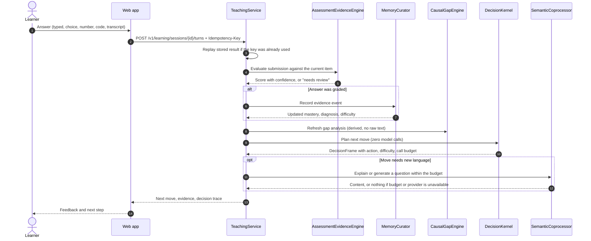
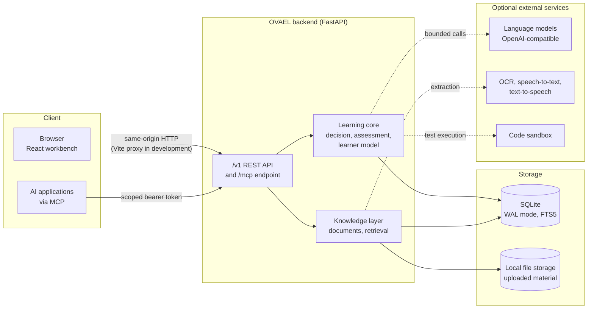
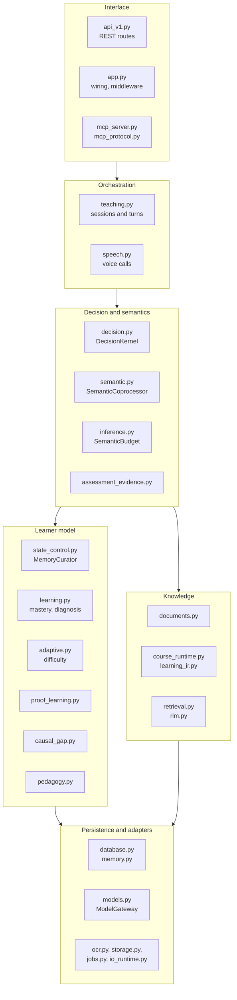
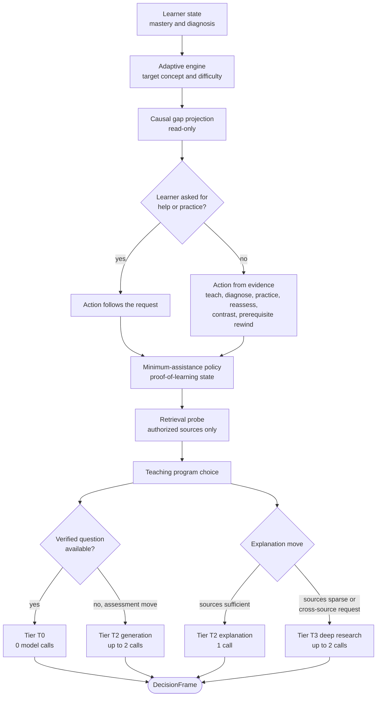
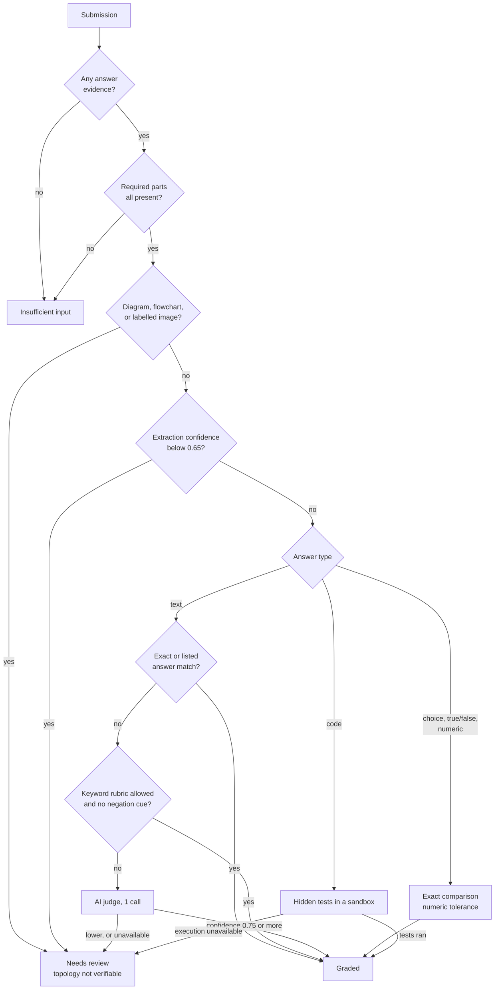
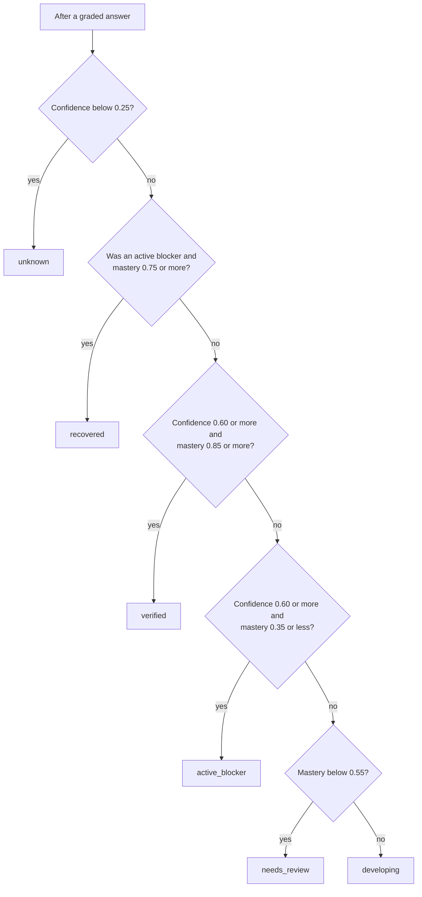
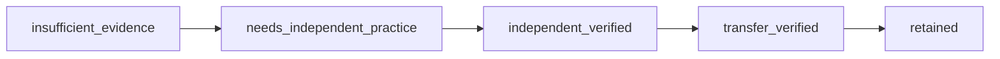
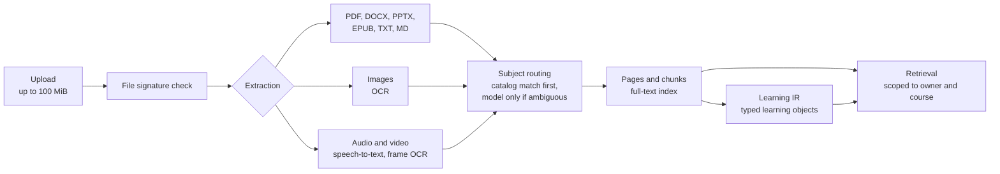
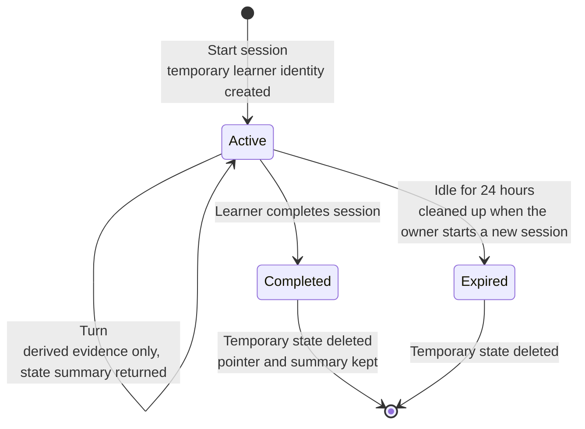

# OVAEL-X

An adaptive learning engine in which deterministic code makes every teaching decision and AI models act only as bounded, budgeted assistants.

**Version 5.0.0** · Python 3.11+ / FastAPI backend · React 18 + TypeScript + Vite frontend · Research and development release

---

## Contents

1. [Overview](#overview)
2. [Design principles](#design-principles)
3. [A learning turn, end to end](#a-learning-turn-end-to-end)
4. [System architecture](#system-architecture)
5. [The decision kernel](#the-decision-kernel)
6. [Assessment and evidence](#assessment-and-evidence)
7. [The learner model](#the-learner-model)
8. [Knowledge and course materials](#knowledge-and-course-materials)
9. [Privacy and security](#privacy-and-security)
10. [Integrations and classroom features](#integrations-and-classroom-features)
11. [The web workbench](#the-web-workbench)
12. [Getting started](#getting-started)
13. [Configuration](#configuration)
14. [API overview](#api-overview)
15. [Testing and continuous integration](#testing-and-continuous-integration)
16. [Project layout](#project-layout)
17. [Capabilities and limits](#capabilities-and-limits)
18. [Further reading](#further-reading)

---

## Overview

OVAEL-X is a tutoring system. A learner chooses a course and a topic. The system then teaches, asks questions, marks the answers, keeps a running picture of what the learner has demonstrated, and decides what to do next: explain again, give a hint, show an example, step back to an earlier idea, or test again.

Its defining choice is **where AI is allowed to act**. Every decision about what happens next is made by ordinary, inspectable code. A language model is consulted only for work that code cannot do itself, such as writing a fresh explanation or judging an ambiguous written answer, and each learner turn may make at most three such calls. When the system cannot verify an answer, it says so instead of guessing, and an unverified answer never changes the learner's recorded progress.

**An illustration.** The system works like a small tutoring centre with four roles, each of which is a real component:

| Role | Component | Responsibility |
| --- | --- | --- |
| Head tutor | `DecisionKernel` | Decides the next step from a fixed rulebook. Never consults the AI. |
| Examiner | `AssessmentEvidenceEngine` | Marks answers. Abstains when correctness cannot be established. |
| Record keeper | `MemoryCurator` | The only component allowed to change what the system believes the learner knows. |
| Outside consultant | `SemanticCoprocessor` with `SemanticBudget` | Writes or judges language when needed, within a hard call limit. |

---

## Design principles

Each principle below is enforced in code, not merely documented.

| Principle | What it means in practice | Enforced in |
| --- | --- | --- |
| Code decides, AI assists | Planning the next move makes zero model calls. | `decision.py` (`DecisionKernel.plan`) |
| Hard call ceiling | Each learner turn shares a budget of three model calls across grading and the next move. Every call must reserve a slot first; an exhausted budget falls back to non-AI behaviour. | `inference.py` (`SemanticBudget`), `teaching.py` |
| Abstain rather than guess | Answers that cannot be verified are returned as "needs review", not marked right or wrong. | `assessment_evidence.py` |
| Only graded evidence counts | An answer with no score is never written to the mastery, difficulty, or proof-of-learning state. | `teaching.py` (`_evaluate_current`) |
| Help is not failure | Asking for an explanation or an example is not recorded as an incorrect attempt. | `teaching.py` (`turn`) |
| No invented lessons | Without a configured model, the learner sees a labelled source excerpt or an explicit "instruction unavailable" message. | `teaching.py` (`_generate_explanation`) |
| Privacy by default | The default `local_first` mode keeps per-session learner state in a temporary copy that is scrubbed afterwards. | `teaching.py`, `config.py` |
| External AI is advisory | Connected AI applications can suggest a teaching strategy but cannot change learner state. | `mcp_server.py` |

---

## A learning turn, end to end

When a learner submits an answer, one request flows through the system:

1. The web app packages the answer into a typed submission (text, choice, number, code, transcript, or a mix) and sends it with an idempotency key, so a retried request is never counted twice.
2. The examiner grades it against the question's answer key, or abstains.
3. If, and only if, the answer received a score, the record keeper updates mastery, difficulty, and proof-of-learning state.
4. The gap analysis refreshes its view of where the learner is struggling and why.
5. The decision kernel plans the next move using code alone.
6. If that move needs new language (an explanation or a new question), the semantic coprocessor produces it within the remaining budget.
7. The response returns the next move, the evidence recorded, and a privacy-safe trace of the decision.



---

## System architecture

The project has two applications. The **backend** is a single FastAPI service that holds all of the learning logic and stores data in one SQLite database plus a local folder for uploaded files. The **frontend** is a React application that talks to the backend through the same origin. External services are all optional: language models, speech recognition and synthesis, OCR, and AI applications that connect through the Model Context Protocol (MCP).



### Backend module map

The backend is a modular monolith. Modules are arranged in layers, and each layer depends only on layers below it.



| Module | Responsibility |
| --- | --- |
| `app.py` | Builds the service graph, middleware (trusted hosts, CORS, security headers), and a legacy compatibility API. |
| `api_v1.py` | The `/v1` REST API, including authentication and CSRF checks at each route. |
| `teaching.py` | Runs learning sessions and turns: idempotency, the goal stack, move generation, and local-first state. |
| `decision.py` | `DecisionKernel`: produces one `DecisionFrame` per transaction without calling a model. |
| `semantic.py` | `SemanticCoprocessor`: explanation, question generation and validation, and ambiguous grading, all budgeted. |
| `inference.py` | `SemanticBudget`: per-turn call ceilings with parent and child budgets. |
| `assessment_evidence.py` | Modality-aware grading with explicit abstention. |
| `state_control.py` | `MemoryCurator`: the single writer of learner evidence and derived state. |
| `learning.py` | Bayesian Knowledge Tracing and gap diagnosis with information-gain question selection. |
| `adaptive.py` | Ability estimation and difficulty targeting. |
| `proof_learning.py` | Acquisition, independence, transfer, and retention evidence, plus the minimum-assistance policy. |
| `causal_gap.py` | Heuristic causes of learning gaps, with abstention and learner challenge. |
| `pedagogy.py` | Chooses a teaching approach from current state and past outcomes; includes the learner-twin view. |
| `documents.py` | Upload validation, text extraction, subject routing, and course concept graphs. |
| `course_runtime.py`, `learning_ir.py` | Course source policy, source roles, and typed learning objects compiled from material. |
| `retrieval.py`, `rlm.py` | Scoped full-text retrieval and the bounded deep-research path. |
| `memory.py`, `database.py` | Persistence, session summaries, compaction, privacy controls, and the SQLite schema. |
| `models.py` | `ModelGateway`: OpenAI-compatible provider access with retries and a circuit breaker. |
| `mcp_server.py`, `mcp_protocol.py` | MCP tools, scopes, connection tokens, and the official SDK transport. |
| `ocr.py`, `speech.py` | OCR, speech-to-text, text-to-speech, and turn-based voice calls. |
| `subjects/` | Built-in subject seeds, the DSA code-evidence service, and the subject-pack registry. |

---

## The decision kernel

The decision kernel is the system's "head tutor". It reads the learner's current state and produces one committed plan, the `DecisionFrame`, before any model is allowed to run. The frame records what to do next, at what difficulty, why, and how many model calls the next step may use. It is read-only with respect to learner state.



On the first turn of a study session, when there is little evidence, the kernel teaches before it tests.

### Semantic tiers

| Tier | Used for | Model calls |
| --- | --- | --- |
| T0 | Structured checks using an existing verified question, routing, state, and all scoring arithmetic | 0 |
| T1 | Reserved for cheap local classifiers; the current kernel does not route to it | 0 |
| T2 | A personalised explanation, or generating a new question when none is available (generate, then validate) | 1 for an explanation, up to 2 for a new question |
| T3 | Deep research when sources are sparse or the learner asks to reconcile sources: one planning call, deterministic retrieval, then the final explanation | up to 2 |

### Budgets

- Each learner turn opens a root budget of **3 calls**, shared by grading the answer and preparing the next move.
- The decision frame's own ceiling is applied as a child budget, so it can only narrow the root budget, never extend it.
- Ambiguous free-text grading draws at most **1 call** from the turn budget.
- The image-transcription endpoint has its own **1-call** budget.
- Budgets count calls within one process. Tokens and cost are not metered.

---

## Assessment and evidence

The examiner accepts answers in many forms and checks them in order of reliability. Exact checks come first, then explicit rubrics, and the AI judge last. It returns a score only when the answer and a validated answer key can establish correctness. Otherwise it returns "needs review" with a reason, and the learner's recorded progress does not change.



| Answer form | How it is graded | When it abstains |
| --- | --- | --- |
| Multiple choice | Selected option index compared with the key | Key or selection missing |
| True / false | Exact boolean comparison | Response is not exactly true or false |
| Numeric | Comparison with relative and absolute tolerance | Key is not a finite number |
| Code | Hidden test cases run in an external sandbox, or in a restricted local process if explicitly enabled | Execution is not configured |
| Short or long text | Exact match, accepted-answer list, opt-in keyword rubric, then at most one AI judgement | Negation or contradiction cues under a keyword rubric; low AI confidence; no model configured |
| Handwriting photo | Text is extracted by OCR, then reviewed and confirmed by the learner before submission | Extraction confidence below 0.65; tasks that need handwriting form rather than content |
| Drawing or diagram | Words in the drawing can be transcribed | Always, for the diagram's structure: arrows and relations are not verified |
| Speech | Transcribed (in the browser, or by the backend during voice calls) and graded as text | Tasks that depend on pronunciation |
| Mixed | Each required part is graded against its own rubric | Any required part is missing or cannot be verified |

Asking for an explanation, an example, or a slower pace is not an assessment attempt and produces no evidence event.

---

## The learner model

The learner model is OVAEL's record of what a learner has shown they can do. It keeps several separate views, because one score cannot distinguish "answered correctly with three hints" from "answered correctly alone, a week later, in a new context". Only the `MemoryCurator` writes to it, and only graded answers move it. Every threshold below is a product starting point set in code, not a validated psychometric standard.

### Mastery

Concept mastery is tracked with Bayesian Knowledge Tracing (`learning.py`). The default parameters are a prior of 0.20, slip 0.10, guess 0.20, and learn rate 0.15, and each concept can override them. Evidence is weighted: answers given after hints or retries move the estimate less, and repeated exposure to the same item counts as weaker evidence. Response time and self-reported confidence never change mastery.



When a concept is read back, it is shown as `stale` if it was verified, recovered, or developing but has not been observed for longer than its review horizon. The horizon is 7 days plus up to 45 more, scaled by confidence. This is computed when the state is read; the stored record is not changed.

### Difficulty

The adaptive engine (`adaptive.py`) keeps a separate ability estimate per concept. It is updated with a Bayesian expected a-posteriori (EAP) step under an item response model that allows for partial credit, then used to choose questions the learner should answer correctly about 65 % of the time. That target can be set between 0.50 and 0.85. Difficulty moves at most 0.08 per step, and early observations stay near the middle, so challenge does not swing from very easy to very hard.

### Proof of learning

`proof_learning.py` separates four kinds of evidence:

| Dimension | Question it answers |
| --- | --- |
| Acquisition | Can the learner do it, with or without help? |
| Independent | Can they do it without hints, on the first attempt, with little assistance? |
| Transfer | Can they apply it to a new kind of problem? |
| Retention | Can they still do it after a delay? |

It also reports the **assistance gap**: the difference between assisted and independent performance. Its first delayed check is scheduled 3 days after a successful independent answer. The interval doubles after each successful recall, up to 30 days, and resets to 3 days after a miss.



**Minimum sufficient assistance.** When a learner asks for help, support escalates in steps: a small cue, then a conceptual hint, then a guided scaffold, then a worked partial example. Each step is taken only after repeated difficulty. When a retention or transfer check is due, the system protects the measurement with an unassisted question, unless the learner explicitly asks for an explanation.

### Gaps and their likely causes

The causal gap engine (`causal_gap.py`) considers concepts that already have evidence and assigns each struggling one a likely cause: prerequisite, misconception, retention, transfer, fragile mastery, or direct foundation. When evidence is thin or low quality, it **abstains**. Each case lists the evidence for and against it, includes a check that would disprove it, and labels its scores as heuristic (`heuristic_v1`) rather than calibrated probabilities. A learner can challenge any case. The case is then treated as uncertain until fresh independent evidence arrives.

### Teaching approach

The dynamic teaching policy (`pedagogy.py`) builds up to eight candidate teaching programs for the current move. Examples include example-first, comparison of rival ideas, a prerequisite bridge, a compact factual path for revision, and a narrative explanation. It ranks them by how similar approaches worked for this learner in similar situations, with older outcomes weighted less (90-day half-life). It deliberately stores no fixed "learning style" label.

### Goals and repair

Each session keeps a goal stack. When the kernel steps back to a prerequisite, a repair goal is pushed with its own budget of 6 attempts. The session returns to the parent goal once the repair succeeds or its budget runs out. Repairs nest at most 3 deep, and an exhausted repair is not re-entered in the same session.

---

## Knowledge and course materials

Learners and teachers can attach their own material to a course. OVAEL extracts the text, decides which subject it belongs to, indexes it for search, and compiles it into typed learning objects such as definitions, examples, procedures, and assessment items. Teaching then draws on that material, with clear rules about which sources are authoritative.



- **Extraction.** Native extraction covers PDF, DOCX, PPTX, EPUB, TXT, and Markdown. Images go through OCR: Tesseract locally, or a configured vision model. Audio and video are transcribed in segments, and video frames are sampled for on-screen text. Archives are checked for unsafe paths and expansion limits.
- **Subject routing.** Material is matched to an existing subject by name, concept, and description overlap. A model is consulted only when that match is weak or ambiguous. Unmatched material gets its own private subject and course.
- **Retrieval.** SQLite FTS5 full-text search, with a lexical fallback when FTS5 is unavailable. Results are scoped to globally verified material, the requester's own material, and course material they can access.
- **Deep research.** For sparse evidence or explicit cross-source questions, one planning call proposes up to three sub-queries. Retrieval for those sub-queries is deterministic, and the final explanation does the synthesis.

### Source authority in a course

Each course has a source policy, its "constitution". Class courses default to teacher material being the authority, with outside knowledge excluded unless the teacher allows it.

| Role | Purpose | Retrieval weight |
| --- | --- | --- |
| `canonical` | The authoritative source for facts and terminology | 1.00 |
| `required` | Required material, such as exams and rubrics | 0.95 |
| `preferred_explanation` | A learner's own linked notes, used for explanation, private to that learner | 0.82 |
| `supplementary` | Additional explanation that may not override canonical claims | 0.68 |
| `reference` | Background reference | 0.60 |

### Course concept graphs

A course owner can ask OVAEL to propose a concept graph from uploaded material. A model may draft the concepts and prerequisite links; without one, a placeholder graph is produced for review. Nothing affects learners until the owner edits and **approves** it. On approval the graph is checked to be acyclic, installed in the course's own private subject namespace, and linked back to the source chunks it came from.

---

## Privacy and security

### Authentication

- **Passwords.** Hashed with Argon2id (time cost 3, 64 MiB memory, parallelism 4). Passwords must be 10 to 256 characters, with no composition rules. Registration issues a 192-bit recovery key, stored only as a hash.
- **Sessions.** Signed access tokens whose IDs are stored server-side, so sign-out and revocation take effect immediately. Opaque refresh tokens rotate on every use.
- **Browsers.** Use HttpOnly session cookies plus a double-submit CSRF token for any request that changes data. Command-line and API clients may use bearer tokens instead.
- **Rate limits.** Sign-in: 8 attempts per 15 minutes. Account recovery: 6 attempts per 30 minutes.
- **Teacher accounts.** Require an administrator-issued invite code unless self-registration is explicitly enabled.
- **Other protections.** Trusted-host checking, optional CORS allow-listing, and security headers on every response. The legacy non-`/v1` API requires an API key or a loopback connection.

### Memory modes

| Mode | Behaviour |
| --- | --- |
| `local_first` (default) | Each teaching session uses a temporary learner identity. Raw answers are not stored: the turn log keeps a hash, and evidence events carry no response text. The client receives a compact state summary after each turn and can supply it again to continue in a later session. |
| `server` | Learner state persists on the server across sessions, including response text in the evidence log. |



### Learner controls

- Personalisation can be paused. While paused, historical learner memory is neither read nor written.
- Learning history can be deleted by subject, by date range, or entirely. Affected state is rebuilt from the evidence that remains.
- Account deletion removes the account's learning, course, document, connection, and audit records, then cleans up stored files.
- Security-relevant actions are written to an audit log.

---

## Integrations and classroom features

### AI applications through MCP

OVAEL exposes its tutoring loop to external AI applications through the Model Context Protocol. The official MCP Python SDK transport is mounted at `/mcp`. A learner creates a connection token with chosen scopes, valid for 1 to 90 days (default 30). Tokens are stored as hashes and can be revoked. External applications can request teaching turns and submit suggestions, but every learner-state change still goes through OVAEL's own grading and record keeping.

| Tool | Required scope | Purpose |
| --- | --- | --- |
| `get_learning_context` | `learning.context.read` | Read a short-lived context capsule (default lifetime 900 s) |
| `search_learning_material` | `learning.materials.search` | Search material the learner is authorised to see |
| `get_learning_map` | `learning.map.read` | Read a compact learning-map projection |
| `begin_teaching_session` | `learning.session.create` | Start an adaptive teaching session |
| `next_teaching_turn` | `learning.session.interact` | Submit a response and receive the next move |
| `submit_teaching_suggestion` | `learning.suggestions.submit` | Offer an advisory strategy for the next move |
| `handoff_to_ovael` | `learning.session.interact` | Create a 10-minute link to continue in the web app |
| `complete_external_session` | `learning.external_events.submit` | Finish a session and queue its evidence for the learner to accept or reject |

### Voice

Voice calls are turn-based. Each spoken turn is transcribed, sent through the same teaching loop as typed input, and the reply can be synthesised to speech. Playback runs from 0.75x to 3.0x, and calls are capped by a configurable maximum duration. Speech-to-text can use a local whisper.cpp binary, an OpenAI-compatible endpoint, or a configured model provider.

### Teachers and classes

Teachers can:
- create class courses and enrol learners,
- set the course source policy and source roles,
- approve concept graphs.

Learners choose whether to share a privacy-minimised progress snapshot. Teachers see only derived progress from learners who opted in: concept status, gap labels, and proof-of-learning indices, never conversations or raw answers. A teacher view suggests per-learner and small-group interventions from that shared evidence:
- verify without scaffolding,
- schedule a delayed retrieval check,
- practise transfer,
- diagnose or repair a gap.

These are decision support only; the teacher decides.

---

## The web workbench

The React application in `frontend/` is the learner's interface.

**Screens**
- Sign-in and registration.
- Course and topic creation, and course material upload.
- A learning session with the full conversation.
- A learning-evidence view and account settings.

**Answer modes**
- Free text, multiple choice, true or false, numeric, and code.
- A photo of handwriting, which is transcribed and must be reviewed and confirmed before it is sent.
- A drawing pad, whose text is transcribed but whose structure is not graded.
- Optional browser speech recognition, which asks for consent first because the browser vendor may process the audio.

**Contract and behaviour**
- `frontend/src/assessment.ts` turns each answer into the backend's typed submission and refuses incomplete submissions locally. For example, a numeric answer must be a finite number, and a task's required answer parts must all be present.
- `frontend/src/api.ts` sends the CSRF token and an idempotency key with every change. A request retried after a lost response reuses the same key.
- Only the teaching-session ID is kept in browser session storage. Tokens and answers are not stored.
- A "View decision" panel shows the decision frame behind each move.

---

## Getting started

### Prerequisites

- Python 3.11 or newer
- Node.js with npm (continuous integration uses Node 22)
- Optional: Tesseract for local OCR, and `ffmpeg`/`ffprobe` for audio and video material

### Backend

```bash
cd backend
python -m venv .venv
# macOS/Linux:        source .venv/bin/activate
# Windows PowerShell: .venv\Scripts\Activate.ps1
python -m pip install -c constraints-tested.txt -e '.[test]'
uvicorn adaptive_backend.app:create_app --factory --host 127.0.0.1 --port 8000
```

Local OCR additionally needs Tesseract installed on the system and `python -m pip install -e '.[ocr]'`.

### Frontend

```bash
cd frontend
npm install
npm run dev
```

Open http://127.0.0.1:5173. The development server forwards `/v1` and `/health` to the backend on port 8000, so cookies and CSRF protection work as they would in production.

**First steps:** register, create a course and a topic, optionally upload material, then start a study or practice session.

**Without a model configured:**
- verified questions, deterministic grading, and all learner-state logic still work;
- explanations fall back to labelled source excerpts, or the system states that instruction is unavailable.

### Optional demo

`backend/scripts/run_backend_demo.py` generates a synthetic demo database locally and starts the backend on the loopback interface with a known synthetic account. It is separate from normal registration and is meant for testing only.

---

## Configuration

Configuration is read from environment variables in `backend/src/adaptive_backend/config.py`. The most commonly used variables are listed below. [`backend/README.md`](backend/README.md) lists every variable with its default.

| Area | Variable | Default | Purpose |
| --- | --- | --- | --- |
| Storage | `ADAPTIVE_DB_PATH` | `./data/adaptive_learning.db` | SQLite database file |
| Storage | `OVAEL_STORAGE_DIR` | `./data/uploads` | Uploaded material |
| Privacy | `OVAEL_MEMORY_MODE` | `local_first` | `local_first` or `server` |
| Security | `OVAEL_AUTH_REQUIRED` | `false` | When `true`, requires `OVAEL_AUTH_SECRET` of 32+ characters |
| Security | `OVAEL_AUTH_SECRET` | random per process | Token signing secret |
| Security | `OVAEL_COOKIE_SECURE` | `false` | Set `true` behind HTTPS |
| Security | `OVAEL_TRUSTED_HOSTS`, `OVAEL_ALLOWED_ORIGINS` | `localhost,127.0.0.1,::1,testserver`; none | Host checking and CORS allow-list |
| Models | `OVAEL_MIMO_BASE_URL`, `OVAEL_MIMO_MODEL`, `OVAEL_MIMO_API_KEY` | provider URL, `mimo-v2.5`, unset | Default OpenAI-compatible provider. Inactive until a key is set. |
| Models | `ADAPTIVE_TUTOR_URL`, `ADAPTIVE_TUTOR_MODEL` | unset | Alternative OpenAI-compatible endpoint |
| Models | `ADAPTIVE_LOCAL_MODEL_URL` | unset | Local model, preferred when configured |
| Models | `ADAPTIVE_SUPERVISOR_URL`, `ADAPTIVE_SUPERVISOR_MODEL` | unset | Separate model for validation and planning |
| Code | `ADAPTIVE_EXTERNAL_SANDBOX_URL` | unset | External sandbox for running code answers |
| Code | `ADAPTIVE_ALLOW_LOCAL_CODE_EXECUTION` | `false` | Development-only restricted local execution |
| Adaptivity | `ADAPTIVE_TARGET_SUCCESS` | `0.65` | Target probability of a correct answer |
| Adaptivity | `ADAPTIVE_MAX_DIFFICULTY_STEP` | `0.08` | Largest difficulty change per update |
| Research | `OVAEL_RLM_ENABLED`, `OVAEL_RLM_MAX_DEPTH` | `true`, `1` | Bounded deep-research path |
| Classes | `OVAEL_TEACHER_INVITE_CODE` | unset | Invite code required for teacher accounts |

---

## API overview

The `/v1` API is the application interface. FastAPI also serves interactive documentation at `/docs`, which follows the same access rule as the legacy API: loopback only, unless an API key is configured.

| Area | Endpoints |
| --- | --- |
| Health and system | `GET /v1/health`, `GET /v1/system/decision`, `GET /v1/judge/latest` |
| Authentication | `POST /v1/auth/register`, `login`, `refresh`, `logout`, `logout-all`, `change-password`, `recover`, `recovery-key`; `GET /v1/auth/me`, `GET`/`DELETE /v1/auth/sessions`, `DELETE /v1/auth/account`; `GET /v1/profile` |
| Courses and topics | `GET`/`POST /v1/courses`, `GET`/`PATCH`/`DELETE /v1/courses/{id}`, `GET`/`POST /v1/courses/{id}/concepts`, `GET /v1/subjects` |
| Course sources | `GET`/`PATCH /v1/courses/{id}/source-constitution`, `GET /v1/courses/{id}/sources`, `PATCH /v1/courses/{id}/sources/{document_id}`, `POST`/`DELETE /v1/courses/{id}/personal-sources`, `GET /v1/courses/{id}/learning-ir`, `POST /v1/courses/{id}/package` |
| Course graphs | `POST`/`GET /v1/courses/{id}/graph/proposals`, `PUT .../{revision_id}`, `POST .../{revision_id}/approve`, `GET /v1/courses/{id}/graph`, `GET /v1/courses/{id}/runtime-spec` |
| Documents and jobs | `POST /v1/documents/upload`, `GET /v1/documents`, `GET`/`DELETE /v1/documents/{id}`, `GET /v1/documents/{id}/pages/{page_no}`, `POST /v1/documents/{id}/route`, `GET /v1/jobs`, `GET /v1/jobs/{id}`, `POST /v1/jobs/{id}/cancel` |
| Learning sessions | `GET`/`POST /v1/learning/sessions`, `GET /v1/learning/sessions/{id}`, `POST /v1/learning/sessions/{id}/turns` (requires `Idempotency-Key`), `POST /v1/learning/sessions/{id}/complete`, `POST /v1/learning/extract-image` |
| Evidence and gaps | `GET /v1/proof-learning`, `GET /v1/proof-learning/retention-due`, `GET /v1/learner-twin`, `POST /v1/gaps/causal/analyze`, `GET /v1/gaps/causal`, `GET /v1/gaps/causal/{case_id}`, `POST .../challenge`, `GET .../plot.png` |
| Memory and privacy | `GET /v1/memory/settings`, `POST /v1/memory/personalization`, `DELETE /v1/memory`, `GET /v1/memory/map` |
| Retrieval | `POST /v1/retrieval/search` |
| Classes | `POST`/`DELETE /v1/courses/{id}/enroll`, `GET /v1/courses/{id}/learners`, `POST /v1/courses/{id}/progress-snapshot`, `GET /v1/teacher/courses/{id}/gaps`, `GET /v1/teacher/courses/{id}/interventions` |
| MCP connections | `GET`/`POST /v1/connections/mcp`, `DELETE /v1/connections/mcp/{id}`, `POST /v1/mcp/context-relay`, `GET /v1/mcp/external-inbox`, `POST /v1/mcp/external-inbox/{id}`, `POST /v1/mcp/handoff/{token}`, and the `/mcp` transport |
| Voice | `POST /v1/voice/calls`, `PATCH /v1/voice/calls/{id}/speed`, `POST /v1/voice/calls/{id}/turn`, `POST /v1/voice/calls/{id}/end` |

A legacy compatibility API (for example `/sessions`, `/events`, `/tutor`, `/subjects/packs`, `/ocr`) remains in `app.py`. It is protected by an API key or loopback-only access, and its tutoring route enters the same decision kernel.

---

## Testing and continuous integration

```bash
# Backend
cd backend
pytest -q
python -m compileall -q src scripts

# Frontend
cd frontend
npm install
npm run test:contracts   # submission-contract tests on the transpiled TypeScript
npm run build            # TypeScript type check and Vite production build
```

The backend suite covers:
- authentication, course isolation, and uploads;
- the decision kernel and budget invariants;
- adversarial grading and abstention cases;
- proof of learning, causal gaps, and MCP behaviour.

The workflow in `.github/workflows/checks.yml` runs on every push and pull request:
- **backend job:** installs with the tested constraints on Python 3.12, runs the test suite, and compiles all sources;
- **frontend job:** runs `npm ci`, the contract tests, and the production build on Node 22.

---

## Project layout

```text
ovael-x/
├── README.md
├── RELEASE_AUDIT.md               Verified release checks and known blockers
├── .github/workflows/checks.yml   Continuous integration
├── backend/
│   ├── pyproject.toml             Package metadata and optional extras (ocr, local-model, test)
│   ├── constraints-tested.txt     Tested FastAPI/Starlette/MCP versions
│   ├── ARCHITECTURE_DECISION_AI.md
│   ├── scripts/                   Demo launcher and synthetic demo generator
│   ├── src/adaptive_backend/
│   │   ├── app.py, api_v1.py      Service wiring and REST API
│   │   ├── teaching.py            Sessions and turns
│   │   ├── decision.py            DecisionKernel
│   │   ├── semantic.py            SemanticCoprocessor
│   │   ├── inference.py           SemanticBudget
│   │   ├── assessment_evidence.py Grading and abstention
│   │   ├── state_control.py       MemoryCurator
│   │   ├── learning.py            Mastery and diagnosis
│   │   ├── adaptive.py            Difficulty
│   │   ├── proof_learning.py      Evidence dimensions
│   │   ├── causal_gap.py          Gap causes
│   │   ├── pedagogy.py            Teaching approach
│   │   ├── documents.py           Material ingestion and course graphs
│   │   ├── retrieval.py, rlm.py   Search and deep research
│   │   ├── memory.py, database.py Persistence and privacy
│   │   ├── mcp_server.py          MCP tools and tokens
│   │   └── subjects/              Built-in subjects and code evidence
│   └── tests/                     Backend test suite
└── frontend/
    ├── src/App.tsx                Learner workbench
    ├── src/assessment.ts          Typed submission contract
    ├── src/api.ts                 CSRF- and idempotency-aware client
    └── tests/                     Contract tests
```

The built-in subjects are seeded at start-up, unless disabled with `ADAPTIVE_SEED_DEMO_DOMAINS=false`:
- **With question items and diagnostic models:** Data Structures & Algorithms, and Biology.
- **Concept structure only, with assessment generated dynamically:** Programming, Game Development, Medical Sciences, Mathematics, Physics, Chemistry, and Computer Systems & Cybersecurity.

---

## Capabilities and limits

| Capability | Status |
| --- | --- |
| Backend API, authentication, courses, sessions | Implemented and covered by regression tests |
| Decision kernel, mastery and proof-of-learning state | Implemented; educational effectiveness has not been measured |
| Multiple choice, true/false, numeric grading | Deterministic when a valid answer key exists |
| Code grading | Requires a test specification and a configured sandbox |
| Free-text grading | Exact answers and explicit rubrics are deterministic; ambiguous answers need a configured model; otherwise the system abstains |
| Mixed submissions | Each required part is graded separately when per-part rubrics exist |
| Handwritten photos | Text extraction only, reviewed by the learner; handwriting form is not assessed |
| Diagrams, charts, flowcharts | No validated structure grader; the system abstains |
| Spoken answers | Browser speech-to-text; pronunciation is not assessed |
| Lessons for new courses | Depend on uploaded material or a configured model; no generic lesson is invented |
| Institutional deployment | Not ready: SQLite storage, no single sign-on or LMS integration, per-process budgets, no large-scale load testing, no browser end-to-end tests |

**OVAEL-X is not intended for grading high-stakes examinations.**
- The negation check used with keyword rubrics is deliberately conservative and is not a complete contradiction detector.
- A model's grade is not independently validated just because the model reports high confidence.
- Teachers or reviewers must be able to override or independently verify any important assessment.
- In `server` mode, and with third-party OCR, speech, or model providers, learner content may be handled differently. Review the configuration before working with sensitive material.

---

## Further reading

- [`backend/ARCHITECTURE_DECISION_AI.md`](backend/ARCHITECTURE_DECISION_AI.md): the decision-first architecture and its escalation rules
- [`RELEASE_AUDIT.md`](RELEASE_AUDIT.md): release verification, scope, and remaining risks
- [`backend/README.md`](backend/README.md): backend installation and the complete configuration reference
