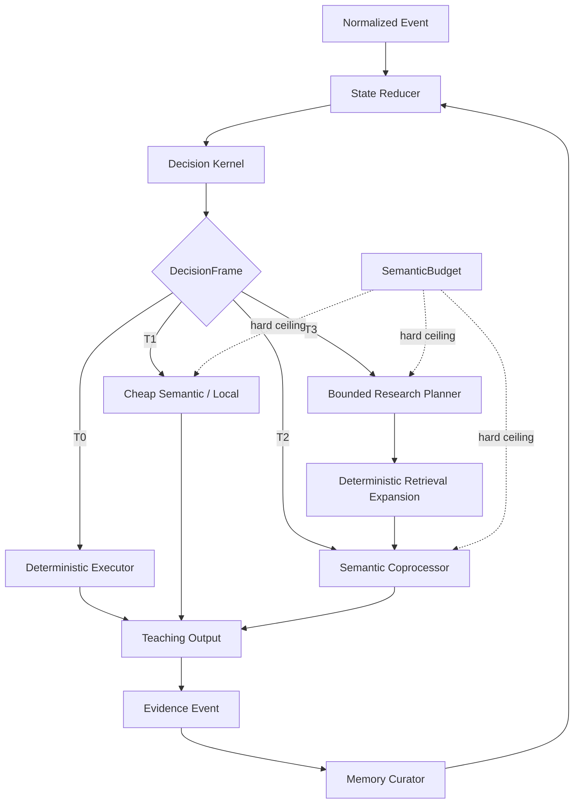

# OVAEL-X Decision + AI Architecture 3.0

## 1. Primary rule

A model is a bounded semantic coprocessor, never the control plane.

The backend first asks whether deterministic software already has enough information to choose the next action. Only unresolved semantic work may cross the model boundary.

## 2. Runtime graph



The Mermaid diagram was syntax-validated during the release audit.

## 3. One DecisionFrame

`DecisionKernel.plan()` unifies the micro-decisions that were previously spread across several runtime interfaces:

- learner diagnosis and uncertainty
- adaptive target concept and difficulty
- causal-gap projection
- learner intent
- first-turn teaching prior
- proof-of-learning state
- minimum sufficient assistance
- source/course scope
- deterministic retrieval coverage
- dynamic pedagogy policy
- reusable question selection
- semantic escalation tier
- per-turn model-call ceiling
- invariants / reason codes

The kernel is read-only with respect to learner truth and performs **zero model calls**.

## 4. Escalation tiers

### T0 — deterministic

Routing, state, goal stack, adaptive math, causal projection, retrieval, source scope, question-bank selection, exact grading, numeric tolerance, code tests, proof-learning updates, retention logic.

### T1 — cheap semantic

Optional local classifier / embedding / reranker work. It is not required for ordinary control flow.

### T2 — bounded generative semantics

Personalized explanations, novel assessment generation when no reusable item exists, and genuinely ambiguous free-text grading.

### T3 — bounded deep research

Only for sparse evidence or genuine cross-source reconciliation. The kernel marks a `deep_candidate`; semantic execution happens afterward under the same turn budget.

## 5. Research split

`HybridKnowledgeEngine.probe()` is deterministic and safe for the control plane.

`HybridKnowledgeEngine.deep_research()` is semantic and requires a caller-owned `SemanticBudget`.

For live teaching the deep path normally uses:

```text
1 planner call
-> deterministic retrieval expansion
-> 1 final teaching call
```

No redundant intermediate synthesis call is needed.

## 6. State ownership

`MemoryCurator` is the single logical writer for learner evidence/state transitions. Model output cannot directly mutate mastery, proof state, causal-gap truth, goals, or adaptive difficulty.

## 7. Assessment rule

Before generating an assessment, the kernel searches for the best reusable verified question. If one exists, generation is forbidden for that transaction.

If generation is required:

1. one generation call
2. deterministic structural validation
3. one independent semantic validation call
4. fallback to a verified anchor if generation/validation fails

## 8. Free-text grading rule

The evaluator applies:

1. exact normalized matching
2. accepted-answer lists
3. required-group / required-term rubrics
4. lexical high-confidence correct/incorrect gate
5. at most one semantic grading call in the ambiguity band
6. weak ungraded evidence when safe grading is unavailable

## 9. Material routing rule

Upload classification is now code-first:

```text
catalog/name/concept overlap
-> strong + separated winner? use it (0 calls)
-> ambiguous? semantic classifier (<=1 call)
-> unavailable? deterministic fallback
```

This is compile-time/course setup work, not per-turn learner control.

## 10. Deployment shape

OVAEL remains a modular monolith. The goal is **one deployable backend with a unified decision contract**, not one giant class and not a microservice mesh.
