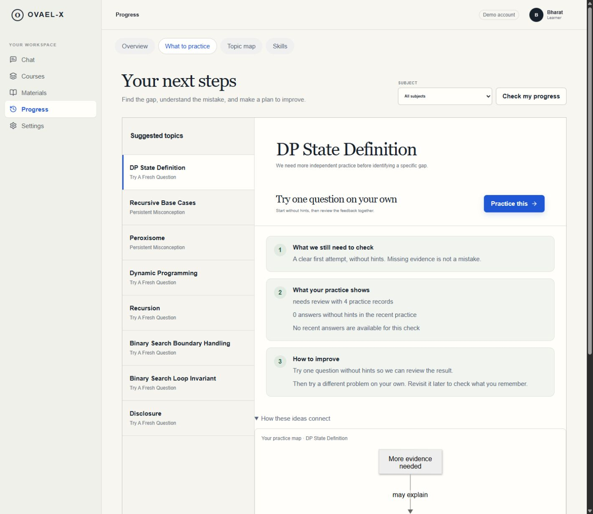

# Cleanup and integration into the existing main branch

Repository: https://github.com/Bharath122babu/ovael-x. No new repository, publication project, or pull request was created.

The local learner/backend integration was committed as `5dbdc78`. The remote main branch had advanced by 23 commits to `7959f74`, containing a separate frontend implementation. The merge preserves both histories and keeps the current learner UI reviewed with the user. App entry and stylesheet conflicts were resolved around that UI.

## Removed

- 103 TypeScript source files in the retired alternate frontend trees: auth, composer, courses, evidence, feedback, layout, learn, materials, multimodal, session, settings, ui, and visuals. Import traversal from `src/main.tsx` confirmed none were used by the active app. They remain recoverable from Git history.
- Fourteen test files that exclusively tested that retired frontend, and two cursor SVG assets exclusively used by its auth page. The active auth/assessment/integration contract suites remain.
- Three untracked legacy screens from the local redesign: AgentsScreen, CallScreen, and ChatScreen. Removed their unreachable routes and duplicate wrappers; retained the actual graph, gaps, skill, history, and connection components used inside Progress and Settings.
- The unused separate scan file picker and its automatic launch branch; the unified material upload still handles images and exposes explicit Learn from this and retry/continuation controls.
- Unused icons, local variables, state, helper functions, and an unwired plot-download handler. The backend plot API remains compatible.
- 679 stylesheet selectors belonging to retired UI paths. App CSS source shrank from 129,068 to 66,861 bytes, approximately 48%. Generic selectors, computed state classes, active UI styles, and Mermaid/math renderer styles remain.

## Preserved and fixed

The deterministic backend, BKT/IRT state, causal-gap analysis, evidence rules, source ownership, cookie/CSRF transport, pending-turn recovery, official MCP server/client, teacher workspace, source imports, and local learner data remain. Timestamped audit and provenance records remain as evidence, rather than being treated as unused application code.

Demo-login autofill was corrected to the documented loopback credential, `OVAEL-demo-2026!`; a branding replacement had incorrectly changed that value. TypeScript now rejects unused locals and parameters in builds. Temporary inspection files are ignored and removed after the audit.

## Verification

- Import traversal reports no unreachable TypeScript modules in the application source.
- Strict TypeScript compilation, including unused-local/parameter checks, passes.
- All 19 active frontend contract tests pass. Production build passes; initial JS is about 469 kB / 145 kB gzip. App CSS is about 55 kB / 11 kB gzip. Optional Mermaid/ELK chunks still issue size warnings.
- Fresh full backend run: 208 tests passed, with one upstream deprecation warning.
- Browser navigation checked Chat, Courses, Materials, Progress overview, gap guidance, topic map, skills, and Settings. The three seeded materials remain visible. The original active Calculus record remains present. Gap guidance still renders its Mermaid map and practice actions. No browser console errors were observed in that check.
- At a 390-pixel viewport, the page and available widths both measured 375 pixels; guidance and settings were checked and the viewport override was reset.

Working API adapters are not a claim of live provider readiness: the current offline demo still needs teaching, OCR, speech and media configuration. No user data or configured secrets are included in the commit.

