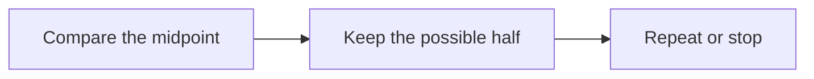

# Visual examples

Synthetic test material for the visual teaching interface. These examples demonstrate presentation; they are not learner evidence.

## Key idea

Binary search keeps a smaller interval after each comparison. For a sorted list, compare the middle value with the target.

```steps
[{"title":"Compare","text":"Compare the target with the middle value."},{"title":"Shrink","text":"Keep the half that can contain the target."},{"title":"Check again","text":"Repeat until you find the target or the interval is empty."}]
```



## Worked formula

For the inclusive interval, the midpoint is $m = l + \lfloor (r-l)/2 \rfloor$.

```terminal
python search_example.py
# Illustrative command only
```

```chart
[{"label":"Initial example interval","value":16},{"label":"After one comparison","value":8},{"label":"After two comparisons","value":4}]
```
