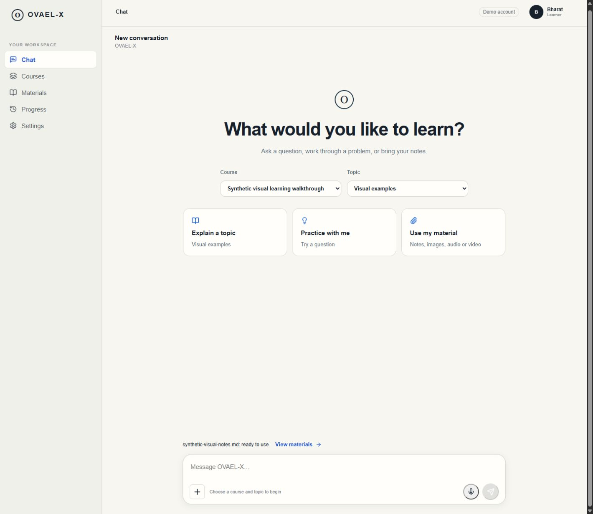
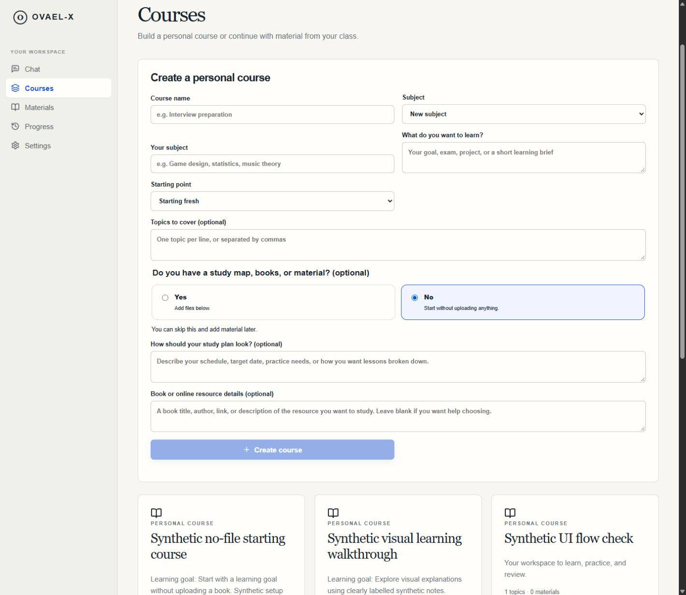
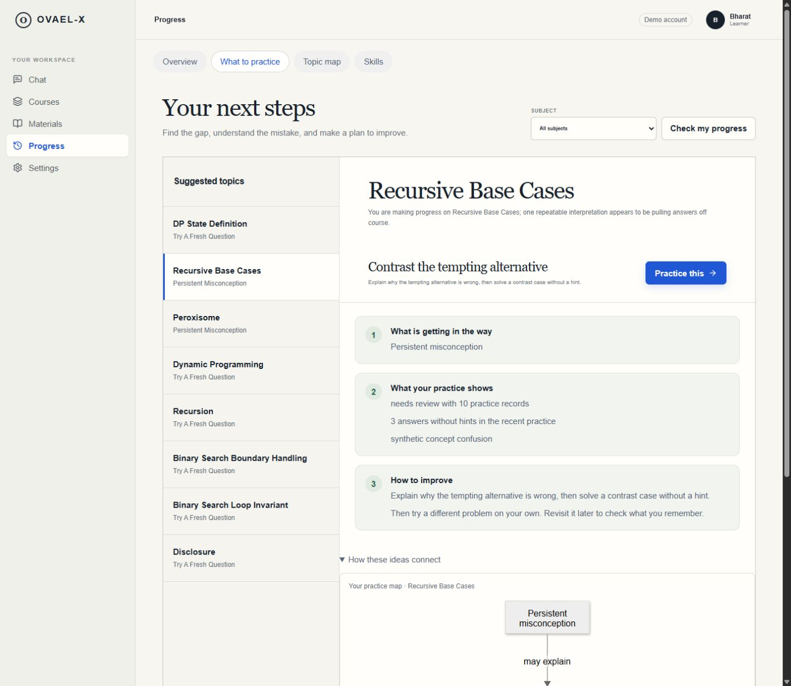
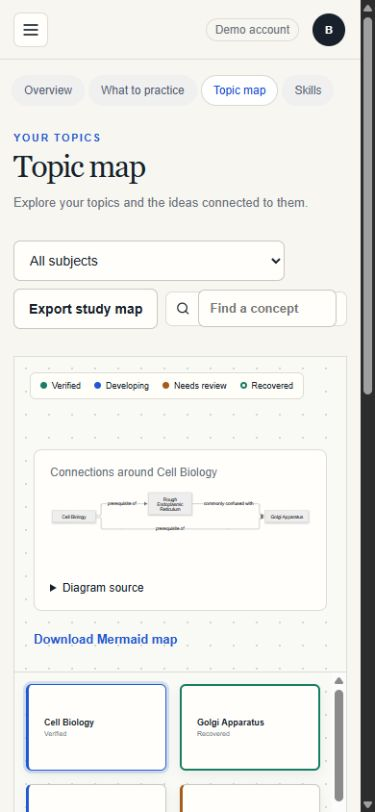

# OVAEL-X: visual teaching and learner guidance

## What stayed and what was removed

Gap detection, its evidence and feedback APIs, the topic graph, proof-of-learning dimensions, BKT concept updates, and Bayesian IRT-style difficulty routing remain in the existing backend. The previous redesign removed separate learner navigation entries for agents/decision traces and voice/OCR, the duplicated Learn/Chat presentation, the debugging sidebar, connected/refresh chrome, the large synthetic banner, and the learning-memory slogan. It did not remove the learning engines. Progress groups their learner-facing views; Materials groups source uploads; the small Demo account label preserves provenance.

The current display name is **OVAEL-X**, following the user's spelling correction.

## Implemented

- Guidance now presents the gap or missing check, actual practice evidence, the next action, and a later independent/retrieval check in one view. Suggested-topic rows use the available width instead of an obsolete three-column layout. The Mermaid map is visible by default. Unknown evidence is not represented as a demonstrated mistake.
- Subject scopes with no report offer first practice. Opening a gap resolves its accessible course and topic; a missing personal course is created through the real API. Private subject launches keep the required course ID.
- Courses default to a custom subject, with a learning goal, starting point, optional topic outline, and books/material. Up to 60 named topics can be imported from an exported study map. Its connections become Markdown/Mermaid reference material; exported statuses never become mastery evidence. New files also appear in Materials.
- Chat renders Markdown, diagrams, formula notation, validated visual step lists, bounded comparison charts, and terminal/code examples. Terminal examples are display-only. Math loads as a separate chunk rather than increasing the initial app script by its full renderer.
- A microphone button uses MediaRecorder, stops tracks on completion/unmount, caps recordings, and sends them to the existing authenticated transcription API. The transcript is reviewed before use; it can also become the first conversation goal. Live calling is not implemented.
- Topic maps offer subject filtering, search, actual relationship diagrams, a readable topic grid, JSON export, and Mermaid export. The old fixed-height canvas no longer clips the mobile grid.
- Skills distinguish existing practice from missing skill checks, explain the four dimensions, hide empty score meters, and offer practice/review actions. Missing proof dimensions do not erase existing BKT/history evidence.
- Completed conversations open an owner-scoped receipt with discussed topics, actual saved responses (including typed choice/numeric/transcribed parts), assessment results, and what came next. Ending a conversation is explicitly separate from topic mastery and full-book reading. Optional model summaries use one bounded call; offline receipts use actual activity without claiming generation.
- Presentation preferences are saved through `PATCH /v1/profile/study-preferences` and included in the teaching model's context: mixed/visual/text, standard/small steps, and plain language. A course's learning brief also reaches explanation context. These choices do not change grading standards or infer a diagnosis.
- Material uploads allow 50 MB in the UI. Image ingestion supports up to 50 MB while retaining the existing pixel guard. PDFs use bounded whole-page rendering with PDFium and OCR; rendering is serialized because PDFium is not thread-safe. At most 30 new scanned pages are attempted per pass, with extracted pages reused on continuation. Materials shows available/total pages and a continuation action. A document with no readable text becomes retryable rather than remaining indefinitely “processing.”
- Image references have actual authenticated search/explanation endpoints, credited captions, a Google Images link, and an explicit vision-explanation action. URLs for backend image reading are restricted to the selected public reference host and downloads are bounded.

## Follow-up: starting without a book

- Following the user's layout correction, course name, subject, goal, starting point, and optional topics appear by default. Below Topics, an optional Yes/No question asks about study maps, books, or material. Yes reveals uploads. No reveals optional study-plan preferences and book/online-resource details. Both choices can be skipped; no upload is required. Plan and reference descriptions are saved in the course brief supplied to teaching context, rather than pretending to fetch or read a linked book.
- Study maps can be PDF, text, Word, or images as reference material, or the exported JSON topic map. Books can be added alongside a map. File selections accumulate without overwriting the imported map and can be removed before submission.
- The plus menu in Chat opens a real saved-file chooser for notes, books, images, recorded audio, and video (50 MB each). It uploads into the selected owned course, or uses the existing automatic routing API, and reports the actual processing result. Saved material is separate from a recorded assessment answer.
- Live speech-to-text is next to Send, on the right; plus stays on the left. Transcripts still require review. No environmental audio was captured during verification.
- Earlier browser verification created **Synthetic no-file starting course** with no files and confirmed its **Getting started** topic. The corrected bottom-of-form Yes and No branches were inspected in the browser. A real plus-menu upload of the existing synthetic notes returned ready and was visible in Materials. At the 390-pixel breakpoint, available/page widths both measured 375 pixels and the mic and Send controls remained adjacent. The temporary viewport was reset.
- Readiness assessment: the presentation and local source-backed workflows exist and have been exercised. The current `/v1/health` still reports teaching, OCR, media, STT, and TTS as unconfigured. Starting without files is supported by course creation; generating a lesson from a goal alone still requires a teaching provider. This is not a claim of complete live teaching or OCR readiness.

## Teaching and personalization direction

Use a mixed presentation: short instructions and worked examples as the core, Mermaid for relationships/processes, formulas for mathematics, code boxes for programming, and images when their source and relevance can be checked. User controls matter more than guessing a fixed learning style or health condition. This follows [W3C guidance on understandable content](https://www.w3.org/WAI/WCAG2/supplemental/objectives/o3-clear-content/), which recommends clear visuals and small, readable text blocks.

BKT and IRT are interpretable baselines, not the entire personalization system. The repository also has prerequisite diagnosis, assistance-aware evidence, retention/transfer dimensions, information-gain checks, and a bounded teaching policy. Improvements to the numerical models should be evaluated on held-out learner data, including calibration, uncertainty, delayed retention, and subgroup error. No new clinical inference, disability classifier, or unvalidated neural replacement was added. [Bayesian IRT research](https://arxiv.org/abs/1604.02336) supports evaluating simpler calibrated baselines before assuming a more complex model improves proficiency estimates.

## Verification and limits

- TypeScript and production builds pass. After cleanup, the initial app script is about 469 kB / 145 kB gzip; the math renderer is lazy-loaded. Optional Mermaid/ELK chunks still emit size warnings. See [cleanup and main integration](cleanup-and-main-merge.md) for the duplicate-file removal audit.
- Nineteen frontend contract tests pass, including visual bounds and imported-ID escaping.
- The latest full backend suite passes all 208 cases. It includes a 120-page rendered PDF completed over four 30-page passes, an image above the old 12 MB limit, owner-scoped receipts, saved preferences, and typed-response retention. OCR was mocked for the scanned-page test: this verifies batching and indexing, not real recognition accuracy.
- Live browser checks created “Synthetic visual learning walkthrough” with a custom subject, topic, and the accompanying synthetic Markdown notes. Uploads, material visibility, course launch, visual steps, Mermaid, math, terminal/chart rendering, a help message, conversation completion, and receipt review reached the actual backend. The original active Calculus conversation was preserved.
- Desktop guidance and 390-pixel responsive views were inspected. Mobile page width matched its available width. Temporary viewport overrides were reset. Topic-map export produced a real downloaded JSON file. The microphone was not used to capture the user's surroundings; protected speech adapters were checked with regression tests.
- Real Commons search returned HTTP 403 with its robot-policy notice. This was not bypassed. The image-search UI reports the upstream failure and retains the external Google Images link. This environment therefore does **not** currently provide a verified live inline image-search result.
- The demo remains offline: no valid replacement teaching/vision/speech key was supplied, and local Tesseract/FFmpeg are still absent. Actual live generated summaries, voice recognition, image explanation, and scanned-text accuracy need service configuration and provider testing. PDF rendering itself is installed and exercised. Long-book processing is an in-process local adapter with durable records and explicit continuation, not a production worker queue.

## Primary implementation references

- [Remark math plugins](https://github.com/remarkjs/remark-math)
- [MediaRecorder API](https://developer.mozilla.org/en-US/docs/Web/API/MediaRecorder)
- [PDFium threading and resource lifecycle](https://pypdfium2.readthedocs.io/en/stable/python_api.html)
- [MediaWiki image metadata API](https://www.mediawiki.org/wiki/API:Imageinfo)

